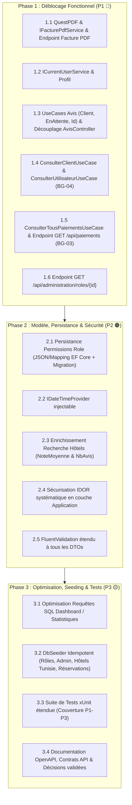

# AUDIT BACKEND ASP.NET CORE — ÉTAT DES LIEUX & PLAN D'ACTION

**Date d'audit :** Novembre 2026  
**Auteur :** Senior .NET Engineer / Architecture & QA  
**Projets audités :** `HotelReservation.Domain`, `HotelReservation.Application`, `HotelReservation.Infrastructure`, `HotelReservation.Api`, `HotelReservation.Tests`  
**Cible :** Consommation complète par le Frontend Angular & Robustesse DDD / Clean Architecture

---

## 1. SYNTHÈSE GLOBALE

| Domaine | Statut | Synthèse |
|---|:---:|---|
| **P1 🔴 Bloquants** | ⚠️ / ❌ | Absence de génération PDF (QuestPDF), endpoints d'avis incomplets avec appels directs aux repositories, absence du endpoint global des paiements et de consultation individuelle d'utilisateur. |
| **P2 🟠 Modèle, Sécurité & Cohérence** | ⚠️ / ❌ | Enums Genre, suppression NbChambresDisponibles et activation chambre déjà migrés. En revanche, **les permissions de l'entité Role ne sont pas persistées en base** (bogue silencieux). Risques IDOR dans les contrôleurs faute d'un `ICurrentUserService` unifié. Pas de `IDateTimeProvider` injectable. |
| **P3 🟡 Structure & DTOs** | ⚠️ / ❌ | Services Dashboard et Statistiques effectuent des `.GetAllAsync()` complets en mémoire au lieu d'agrégats SQL. Aucun `DbSeeder` idempotent n'existe pour initialiser les comptes (Admin, Agent, Client) et les données de démonstration. |
| **Tests & Build** | ✅ | Solution .NET 10.0 compile (0 erreurs, 0 warnings). 27 tests unitaires existants passent avec succès. |

---

## 2. AUDIT DÉTAILLÉ PAR POINT

### SECTION 3 : PHASE 1 (P1 🔴 — BLOQUANTS)

| Réf | Point d'audit | État | Fichiers concernés | Risque & Analyse |
|---|---|:---:|---|---|
| **1.1** | **Facture PDF (QuestPDF)** | ❌ | *Nécessite* : `IFacturePdfService`, `FacturePdfService`, `GenererFacturePdfUseCase`, `PaiementsController` | **Élevé (BG-01)**. Le frontend dispose du bouton de téléchargement de facture. Le backend ne renvoie actuellement qu'un JSON `FactureDto`. Aucun moteur PDF n'est installé. |
| **1.2** | **Profil utilisateur (GET/PUT)** | ⚠️ | `AuthController.cs`, `ConsulterMonProfilUseCase.cs`, `ModifierSonProfilUseCase.cs` | **Moyen**. Les endpoints `/api/auth/profil` existent mais lisent les claims HTTP directement dans le contrôleur. Manque d'abstraction `ICurrentUserService` pour injecter l'identité en couche Application. |
| **1.3** | **Consultations des avis & Découplage** | ⚠️/❌ | `AvisController.cs`, `AdministrationController.cs`, `IAvisRepository.cs` | **Élevé (BG-02)**. `AvisController` viole la Clean Architecture en interrogeant directement `_avisRepository`. Manquent les endpoints `/api/avis/client/{clientId}`, `/api/avis/en-attente` (ou `/api/administration/avis?statut=...`), et `/api/avis/{id}`. |
| **1.4** | **Consultation réservation par ID** | ⚠️ | `ReservationsController.cs`, `ConsulterReservationUseCase.cs` | **Moyen**. L'endpoint `GET /api/reservations/{id}` existe et passe par un use case, mais la vérification de propriété client vs personnel est encore traitée en partie dans le contrôleur au lieu d'un service d'autorisation applicatif. |
| **1.5** | **Liste globale des paiements** | ❌ | `PaiementsController.cs`, *Nécessite* : `ConsulterTousPaiementsUseCase` | **Élevé (BG-03)**. Impossible pour le personnel ou l'administrateur de lister l'ensemble des paiements avec filtres et pagination. Seuls `GET /api/paiements/me` et `GET /api/paiements/reservation/{id}` existent. |
| **1.6** | **Chambres publiques** | ✅ | `ChambresController.cs` | **Faible**. `GET /api/hotels/{hotelId}/chambres` et `GET /api/chambres/recherche` sont déjà configurés sans `[Authorize]` et accessibles au public. |
| **1.7** | **Endpoints de rôles** | ⚠️ | `AdministrationController.cs`, `GererRolesUseCase.cs` | **Faible**. `GET /api/administration/roles` existe. Il manque `GET /api/administration/roles/{id}` pour la consultation d'un rôle unitaire. |

---

### SECTION 4 : PHASE 2 (P2 🟠 — MODÈLE, SÉCURITÉ & COHÉRENCE)

| Réf | Point d'audit | État | Fichiers concernés | Risque & Analyse |
|---|---|:---:|---|---|
| **2.1** | **Enum Genre & Migration** | ✅ | `Genre.cs`, `Utilisateur.cs`, `20261004195225_AjouterEnumGenre.cs` | **Nul**. `Genre` (Homme=1, Femme=2) est créé, configuré et migré avec succès dans la base. |
| **2.2** | **Suppression Hotel.NbChambresDisponibles** | ✅ | `Hotel.cs`, `20261004200110_SupprimerNbChambresDisponibles.cs` | **Nul**. Le champ a bien été supprimé du modèle et de la base. Le calcul dynamique est assuré. `Hotel.NbChambres` est conservé. |
| **2.3** | **Enrichissement recherche hôtels** | ⚠️ | `RechercherHotelsUseCase.cs`, `HotelDtos.cs`, `RechercheDtos.cs` | **Moyen**. `RechercherHotelsUseCase` calcule le prix minimum à partir des chambres, mais ne calcule ni `NoteMoyenne` ni `NbAvis` agrégés à partir des avis validés. `HotelDto` et `HotelResultatRechercheDto` doivent exposer ces données. |
| **2.4** | **Propriété Chambre.Actif & Migration** | ✅ | `Chambre.cs`, `20261004200531_AjouterActivationChambre.cs` | **Nul**. Propriété `Actif` présente avec méthodes `Activer()` / `Desactiver()` et contrôle d'invariance (impossible de désactiver une chambre occupée). |
| **2.5** | **Persistance des Permissions de Role** | ❌ | `Role.cs`, `AppDbContext.cs`, `AppDbContextModelSnapshot.cs` | **Élevé (Critique)**. `Role.cs` possède `_permissions = new List<string>()`, mais `AppDbContext` ne mappe absolument pas ce champ (ni table jointe ni colonne JSON). Tout appel à `AjouterPermission` est perdu après `SaveChangesAsync`. |
| **2.6** | **Sécurité IDOR & Application Layer** | ⚠️ | `PaiementsController.cs`, `ReservationsController.cs`, `FavorisController.cs` | **Élevé**. L'autorisation métier dépend des claims HttpContext injectés manuellement dans les contrôleurs. Il faut formaliser un `ICurrentUserService` pour garantir que la couche Application bloque systématiquement l'accès aux réservations, factures, favoris ou paiements d'un autre client. |
| **2.7** | **Contrôle d'accès Dashboard / Statistiques** | ✅ | `ConsulterDashboardUseCase.cs`, `DashboardController.cs` | **Faible**. Le use case applique strictement la séparation : Agent = (Réservations du jour, Paiements en attente, Dernières réservations) ; Admin = métriques complètes + graphiques + `/api/dashboard/statistiques`. |
| **2.8** | **Dates & Injectable TimeProvider** | ❌ | Tous les use cases & services | **Moyen**. Utilisation directe de `DateTime.UtcNow`. L'introduction d'un `IDateTimeProvider` injectable est requise pour assurer le déterminisme des tests. |
| **2.9** | **Domain Events** | ⚠️ | `HotelReservation.Domain/Events/` | **Faible**. `ReservationConfirmeeEvent` et `ReservationAnnuleeEvent` existent avec handlers. Manque `ReservationCreeeDomainEvent` si notification requise. |
| **2.10** | **Règles d'intégrité & Suppression** | ✅ | `AppDbContext.cs` | **Faible**. Cascade deletes et restrict constraints bien configurés (Restrict sur Reservation et Paiement, Cascade sur Chambres et Avis). |

---

### SECTION 5 : PHASE 3 (P3 🟡 — STRUCTURE, DTOs & SEED)

| Réf | Point d'audit | État | Fichiers concernés | Risque & Analyse |
|---|---|:---:|---|---|
| **3.1** | **Optimisation TableauDeBord & Statistiques** | ⚠️ | `TableauDeBordService.cs`, `StatistiqueService.cs` | **Moyen**. Les méthodes font `await _repository.GetAllAsync()` puis des calculs LINQ en mémoire. Nécessite une optimisation pour exécuter des requêtes de comptage et de somme directes en base. |
| **3.2** | **Use Cases manquants pour Utilisateur** | ⚠️ | `ClientsController.cs`, *Nécessite* : `ConsulterClientUseCase`, `ConsulterUtilisateurUseCase` | **Moyen (BG-04)**. `ClientsController.GetById` lit directement `_clientRepository.GetByIdAsync(id)`. Un use case `ConsulterUtilisateurUseCase` doit également permettre à l'administrateur de consulter un utilisateur par son identifiant unique. |
| **3.3** | **Agrégat Hotel et Chambres (DDD)** | ✅ | `Hotel.cs`, `Chambre.cs`, `HotelRepository.cs` | **Nul**. Parfait respect des principes DDD : pas de `IChambreRepository` autonome, toutes les modifications passent par l'agrégat `Hotel`. |
| **3.4** | **Calendrier de disponibilité dérivé** | ✅ | `ConsulterCalendrierReservationsUseCase.cs` | **Nul**. Conforme à la règle : aucune table Calendrier créée, dérivation en mémoire à partir des chambres et réservations actives. |
| **3.5** | **DbSeeder Idempotent** | ❌ | *Nécessite* : `DbSeeder.cs` | **Élevé**. Absence totale de classe de seed. La base de données démarre vide, sans compte Administrateur initial ni données de démonstration d'hôtels et réservations. |
| **3.6** | **Validation FluentValidation complète** | ⚠️ | `HotelReservation.Application/Validators/` | **Moyen**. Des validateurs existent pour certaines requêtes clés, mais plusieurs DTOs de mutation n'ont pas de validateur dédié enregistré. |

---

## 3. PLAN D'EXÉCUTION TECHNIQUE

---

## 4. RISQUES ET CONTRAINTES TECHNIQUES IDENTIFIÉS

1. **Persistance des Permissions de Role :** Requiert une nouvelle migration EF Core (`AjouterPermissionsRole`) sans altérer les migrations antérieures ni casser le `ModelSnapshot`.
2. **Package QuestPDF :** Doit être ajouté avec la licence Community (`QuestPDF.Settings.License = LicenseType.Community;`).
3. **Environnement d'exécution :** L'exécutable `git` n'étant pas disponible dans le PATH système de la machine hôte, les jalons de validation sont scellés par des builds vérifiés `dotnet build --no-restore` et la suite de tests automatisée `dotnet test`.
