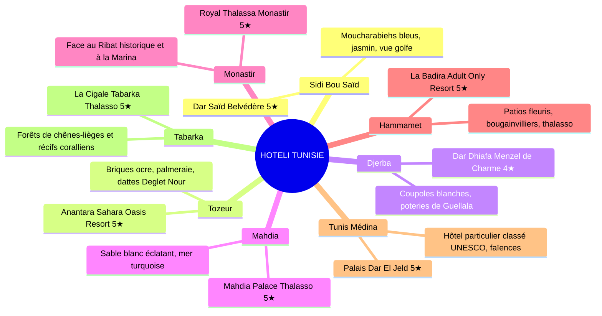

# AUDIT & PLAN D'ENRICHISSEMENT DU SEEDER — HOTELI
## `docs/HOTELI_SEEDER_AUDIT.md`

**Projet :** HotelReservationApp $\rightarrow$ **HOTELI**  
**Date d'audit :** 17 Novembre 2026  
**Fichier source analysé :** `HotelReservation.Infrastructure/Data/DbSeeder.cs`  
**Statut :** Diagnostic en lecture seule (Phase 1) — Aucune modification effectuée  

---

## 1. ÉTAT DES LIEUX DU SEEDER ACTUEL

Actuellement, `DbSeeder.cs` initialise :
- **3 Rôles de sécurité :** `Administrateur`, `Agent`, `Client` avec leurs permissions descriptives.
- **3 Utilisateurs types :**
  - Administrateur : `admin@hotelapp.com` (Mehdi Ben Salah, Tunis)
  - Agent : `agent@hotelapp.com` (Sonia Trabelsi, Tunis)
  - Client : `client@hotelapp.com` (Youssef Gharbi, Ariana)
- **4 Hôtels seulement :**
  1. *The Residence Tunis* (Gammarth, 5★, 4 chambres)
  2. *Four Seasons Hotel Tunis* (Gammarth, 5★, 2 chambres)
  3. *Mövenpick Resort & Marine Spa Sousse* (Sousse, 5★, 2 chambres)
  4. *Hasdrubal Prestige Thalassa & Spa* (Djerba, 5★, 1 chambre)
- **2 Réservations, 2 Paiements, 2 Avis et 2 Favoris** rattachés au client type.

**Constat d'audit :**
- Les destinations emblématiques indispensables au tourisme tunisien (**Sidi Bou Saïd, Tozeur, Mahdia, Monastir, Hammamet, Tunis Médina, Tabarka**) sont totalement absentes du catalogue initial.
- Le catalogue actuel est restreint à 4 adresses et 9 chambres au total, ce qui ne permet pas d'illustrer la richesse des régions tunisiennes demandée par le concept HOTELI.

---

## 2. PLAN DE DIVERSIFICATION TOURISTIQUE RÉGIONALE (8 DESTINATIONS CLÉS)

Le catalogue enrichi proposera une sélection de **8 établissements d'exception** couvrant la palette complète des terroirs et architectures de la Tunisie :



---

## 3. PROFIL DÉTAILLÉ DES ÉTABLISSEMENTS PROPOSÉS AU SEEDER

### 1. SIDI BOU SAÏD — *Dar Saïd — Maison d'Hôtes & Belvédère* (5 Étoiles / Charme Andalou)
- **Destination :** Sidi Bou Saïd, Rue Toumi
- **Architecture & Cadre :** Demeure historique du XIXe siècle aux façades immaculées rehaussées du célèbre bleu indigo, portes cloutées artisanales, moucharabiehs sculptés et patios parfumés au jasmin et bougainvilliers en fleur.
- **Prestations & Expériences :** Piscine intimiste nichée dans un jardin méditerranéen, terrasse panoramique plongeant sur le golfe de Tunis et le mont Boukornine, salon de thé traditionnel servant thé à la menthe aux pignons et bambalounis tièdes.
- **Chambres :**
  - Chambre Supérieure *"Jasmin"* (Double, 340 DT / nuit)
  - Suite Arabo-Andalouse *"Golfe de Carthage"* (Suite, 620 DT / nuit)

### 2. TOZEUR — *Anantara Sahara Tozeur Resort & Oasis* (5 Étoiles / Luxe Saharien)
- **Destination :** Tozeur, Route Mrah Lahouach
- **Architecture & Cadre :** Chef-d'œuvre architectural inspiré des traditions oasiennes, intégrant les célèbres briques pleines ocre de Tozeur posées en relief géométrique. Havre de paix niché aux portes du désert du Sahara et face à une palmeraie luxuriante.
- **Prestations & Expériences :** Dégustation privative de dattes Deglet Nour millésimées au coucher du soleil, dîners bédouins sous tente saharienne étoilée, hammam berbère aux vapeurs d'eucalyptus et excursions guidées dans les oasis de montagne (Chebika, Tamerza).
- **Chambres :**
  - Chambre Deluxe *"Palmeraie"* (Double, 390 DT / nuit)
  - Villa Saharienne avec Piscine Privative *"Chott El Djérid"* (Suite, 880 DT / nuit)

### 3. DJERBA — *Dar Dhiafa — Menzel & Houch Insulaire* (4 Étoiles / Authenticité de l'Île)
- **Destination :** Djerba, Village d'Erriadh
- **Architecture & Cadre :** Menzel djerbien traditionnel composé de houchs chaulés à la blancheur éclatante, coupoles douces, alcôves intimes, poteries artisanales de Guellala et tissages en lin naturel.
- **Prestations & Expériences :** Deux patios ombragés avec bassins d'eau douce, cuisine insulaire mettant à l'honneur les poissons pêchés du jour aux épices du Sud, parcours artistique au cœur de Djerbahood.
- **Chambres :**
  - Chambre Traditionnelle *"Sidi Mahrez"* (Simple/Double, 220 DT / nuit)
  - Suite de Charme *"La Palmeraie de Houmt Souk"* (Suite, 450 DT / nuit)

### 4. MAHDIA — *Mahdia Palace Thalasso & Beach* (5 Étoiles / Joyau Maritime)
- **Destination :** Mahdia, Zone Touristique
- **Architecture & Cadre :** Architecture néo-mauresque élégante s'ouvrant sur la plus belle plage de sable blanc fin de Tunisie et une eau d'une transparence turquoise remarquable.
- **Prestations & Expériences :** Centre de thalassothérapie d'eau de mer chauffée, restaurant de fruits de mer en front de mer, terrasses lounge face au soleil levant.
- **Chambres :**
  - Chambre Front de Mer *"Cap Afrique"* (Double, 280 DT / nuit)
  - Suite Familiale Vue Mer (Familiale, 520 DT / nuit)

### 5. MONASTIR — *Royal Thalassa Monastir* (5 Étoiles / Balnéaire & Patrimoine)
- **Destination :** Monastir, Baie de Skanès
- **Architecture & Cadre :** Vaste domaine balnéaire aux colonnades de marbre et jardins de palmiers, situé à quelques minutes du majestueux Ribat historique de Monastir et de la marina.
- **Prestations & Expériences :** Spa marin de renommée internationale, club nautique, piscine lagon extérieure.
- **Chambres :**
  - Chambre Double Supérieure (Double, 260 DT / nuit)
  - Suite Présidentielle *"Hannibal"* (Suite, 690 DT / nuit)

### 6. HAMMAMET — *La Badira — Demeure de Charme Méditerranéenne* (5 Étoiles / Sérénité)
- **Destination :** Hammamet, Baie Nord
- **Architecture & Cadre :** Écrin moderne et poétique inspiré des artistes des années 1930 (Paul Klee, Jean Cocteau) ayant séjourné à Hammamet. Arcades épurées, jeux de lumière, fontaines et patios ombragés.
- **Prestations & Expériences :** Spa Clarins aux senteurs de fleur d'oranger, restaurant gastronomique réinterprétant le patrimoine culinaire tunisien, piscine à débordement dominant l'horizon marin.
- **Chambres :**
  - Suite Junior *"Noria"* (Double, 360 DT / nuit)
  - Suite Signature vue mer (Suite, 720 DT / nuit)

### 7. TUNIS MÉDINA — *Palais Dar El Jeld Hotel & Spa* (5 Étoiles / Patrimoine UNESCO)
- **Destination :** Tunis, Médina Historique (Rue Dar El Jeld)
- **Architecture & Cadre :** Ancien hôtel particulier restauré dans les règles de l'art, mariant faïences de Qallaline peintes à la main, plafonds en bois ciselé, marbre d'Italie et stucs andalous.
- **Prestations & Expériences :** Hammam traditionnel aux huiles essentielles de romarin, rooftop panoramique avec vue à 360° sur les toits de la Médina et la mosquée Zitouna.
- **Chambres :**
  - Suite de Luxe *"Médina"* (Suite, 580 DT / nuit)

### 8. TABARKA — *La Cigale Tabarka Thalasso & Golf* (5 Étoiles / Nature & Mer)
- **Destination :** Tabarka, Côte du Corail
- **Architecture & Cadre :** Entre les célèbres Aiguilles de Tabarka, les forêts denses de chênes-lièges et les eaux poissonneuses de la côte du Corail.
- **Prestations & Expériences :** Parcours de golf 18 trous de championnat, plongée sous-marine à la découverte des récifs coralliens, cures thalasso vivifiantes.
- **Chambres :**
  - Chambre Forêt & Mer (Double, 310 DT / nuit)
  - Suite Vue Golf & Récifs (Suite, 640 DT / nuit)

---

## 4. RÈGLES DE SÉCURITÉ ET D'IDEMPOTENCE DU SEEDER

Conformément à la section 9.7 du protocole :
1. **Idempotence absolue :** Chaque hôtel sera vérifié par son identifiant unique ou son nom avant insertion :
   ```csharp
   if (!await context.Hotels.AnyAsync(h => h.Id == hotelId))
   ```
2. **Préservation des comptes existants :** Les utilisateurs types (`admin@hotelapp.com`, `agent@hotelapp.com`, `client@hotelapp.com`) et leurs rôles ne sont ni écrasés ni modifiés.
3. **Validité des relations EF Core :** Chaque chambre créée sera instanciée via la méthode d'agrégat `hotel.AjouterChambre(...)` pour garantir l'intégrité référentielle et les invariants DDD.
4. **Devises :** Toutes les chambres utiliseront la devise officielle `"TND"` avec des montants réalistes.
5. **Images fiables :** Sélection exclusive d'URLs Unsplash pérennes, à haute résolution et respectant les conditions d'utilisation.
